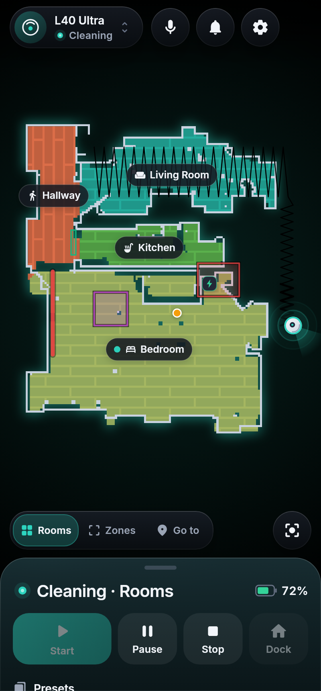
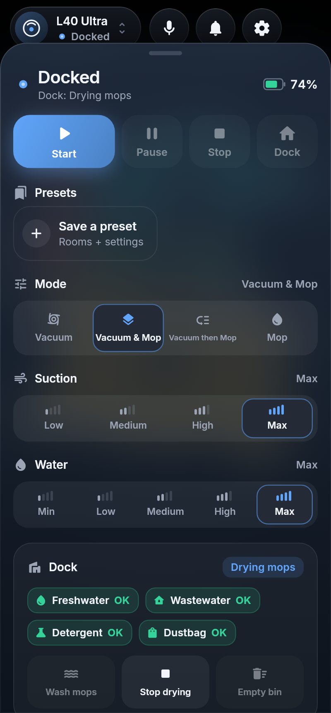
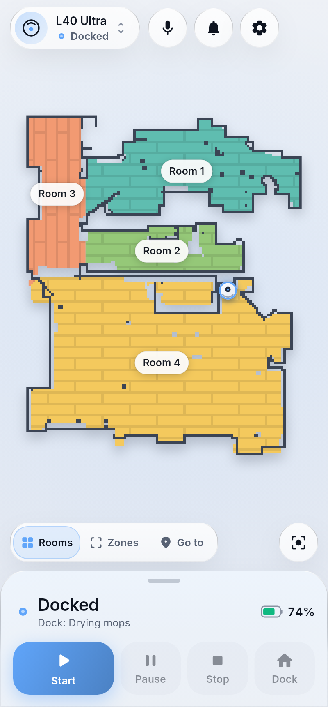
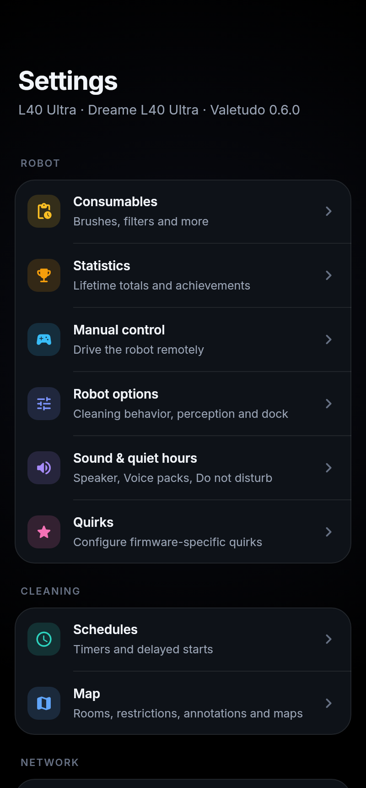

<p align="center">
  
</p>

<h1 align="center">Valrove</h1>

<p align="center">
  <strong>The app your Valetudo robot deserves.</strong><br>
  Map-first, fast and cloud-free. No account, no ads, no tracking.
</p>

<p align="center">
  
  
  <a href="LICENSE"></a>
  <a href="https://ko-fi.com/valrove"></a>
</p>

---

**Is Valetudo's web UI too plain or too dated for you?** You freed your robot from the
cloud, and now you control it through a web page in your phone's browser. Valrove turns
that into a real app: your home's live map fills the screen, glass controls float above
it, and everything Valetudo can do is a tap away.

It talks to your robot directly on your own network, through Valetudo's local API. No
cloud in between.

<p align="center">
  
  
  
  
</p>

## Why Valrove

- **The map comes first.** A live, smooth map with the robot gliding along its cleaning
  path. Tap rooms to clean them, draw zones, or send the robot anywhere.
- **Everything the web UI does.** Rooms, zones, schedules, consumables, map editing,
  virtual walls, dock controls, Wi-Fi, MQTT, updates, logs and more. Valrove reads what your
  robot supports and shows exactly that.
- **One-tap cleanups.** Save rooms, order and settings as presets, then start them from the
  app, a home screen widget, a quick settings tile or an app shortcut.
- **Know what's going on.** A live notification while the robot cleans, with Pause and Dock
  buttons, plus alerts when it's done, stuck, or the bin is full.
- **Talk to it.** "Clean the kitchen and the hallway twice" or "go back to the dock", in
  English or German.
- **It learns your home.** Time and battery estimates before you start, a cleaning
  history, a map of when each room was last cleaned, Wi-Fi coverage, and a forecast of
  when brushes and filters will wear out.
- **Looks good doing it.** Light and OLED-black dark themes that tint themselves to what the
  robot is doing, with haptic feedback throughout.
- **Private by design.** No cloud, no account, no analytics. Valrove connects only to
  your robot. (Voice commands use your phone's own speech recognition.) See the
  [privacy policy](PRIVACY.md).

## Download

Get the latest APK from the [Releases](../../releases) page. Most phones need
`app-arm64-v8a-release.apk`.

You need:

- an Android phone with Android 7.0 or newer,
- a robot vacuum running [Valetudo](https://valetudo.cloud),
- the phone on the same network as the robot.

Valrove finds Valetudo robots on your network by itself, or you enter the robot's address.
Several robots are supported.

No Valetudo robot yet? Tap **Try the demo** on the first screen to look around with a
pretend robot.

## Support Valrove

Valrove is free, with no ads and no tracking. If it makes your robot more fun to use:

- ☕ [Buy me a coffee on Ko-fi](https://ko-fi.com/valrove)
- ⭐ Star this repository and tell other Valetudo users about it
- 🐞 Report bugs and ideas in [Issues](../../issues)

## Thanks to Valetudo

Valrove would not exist without [Valetudo](https://valetudo.cloud) by Sören Beye and its
contributors, which frees robot vacuums from the cloud in the first place. Valrove is an
independent app and is not affiliated with or endorsed by the Valetudo project.

---

## All features

The goal is parity with the user-facing features of Valetudo's web interface. Every
screen is driven by the capabilities the robot reports, so anything the robot can't
do doesn't appear.

- **Home / map**: live map over server-sent events, an animated robot marker with its
  cleaning trail, room selection (with selection order where supported), multiple zones,
  go-to location, iteration count, and integration payloads (MQTT/REST JSON) on long-press.
  Also obstacle markers with photos, and a room long-press menu.
- **Controls**: start, pause, stop, home and locate, fan/water/operation presets,
  dock actions (empty, mop wash/dry and others), attachments, current cleanup statistics,
  events and notifications, and confirmation of pending map changes.
- **Robot**: consumables (with reset), lifetime statistics, manual and high-resolution
  manual control (with the camera view and the camera light switch on the same
  page), the camera live view, robot options (carpet, mop, dock, avoidance,
  key lock and others), sound and quiet hours (volume, test sound, voice packs, do not
  disturb), and quirks.
- **Schedules**: timers with full action and pre-action editing (time-zone shift aware)
  and delayed start.
- **Map management**: persistent maps, mapping pass, map reset, multi-map
  (switch/rename/rotate/delete), map export, and editors for rooms (join, split, rename,
  floor material, clean order), virtual restrictions (walls, no-go and no-mop areas) and
  annotations. Also the coverage map.
- **Connectivity**: Wi-Fi (status, scan, reconfigure), MQTT, NTP, HTTP basic auth and
  network advertisement. New robots still in access-point mode get a Wi-Fi provisioning flow.
- **System**: Valetudo options, updater, live log with log level, system information,
  help, and about (versions, licenses, API docs link).
- **App**: several robots, a demo robot for trying the app without one, mDNS discovery (`_valetudo._tcp`), credentials in platform
  secure storage, light/dark/system theme, and haptics.

Beyond the web interface:

- **Cleaning notifications** (Android): while the robot cleans, a foreground service
  polls it every five seconds and shows a live notification (rooms, area, time,
  battery) with Pause/Resume and Dock buttons. Separate alerts announce a finished
  cleanup, a robot that needs help, a full dust bin and used-up consumables. The service
  starts when the app sees a cleanup begin and stops when the robot is back. It can be
  turned off in the app settings.
- **Presets**: saved cleanups (rooms in order, passes, mode, suction, water) that start
  with one tap from the home sheet, the home screen widget (Android), the quick settings
  tile (first preset, Android) and the app-icon shortcuts. Selected rooms can be saved as
  a preset straight from the map.
- **Estimates**: expected time and battery use before starting, learned from the
  recorded cleanups (typical values until there are some).
- **History**: every cleanup Valrove sees is recorded on the phone with its rooms, area,
  time, battery, path and obstacles. A map colours rooms by when they were last cleaned.
  With notifications off (and on iOS), cleanups are only recorded while the app is open.
- **Settings per room**: a preset can give rooms their own mode, suction and water.
  It then runs as several cleanups in a row (neighbouring rooms with equal settings
  share one); each step starts when the robot finished the previous one. A step that
  doesn't finish cancels the rest.
- **Wi-Fi coverage**: while the robot cleans, its Wi-Fi signal is recorded where it is
  (every 10 seconds, on a 50 cm grid), giving a signal map of the home.
- **Lost & found**: obstacles the robot recognises are kept with their photo, room and
  time, after the map has forgotten them.
- **Consumable forecast**: the wear rate of each consumable is learned from its readings
  (or, for parts counted in minutes, from the cleaning time per day), shown as "about
  3 weeks left", with a reminder a week before a part runs out.
- **Voice commands**: the microphone in the top bar understands commands such as "clean
  the kitchen and the hallway twice", "start After dinner", "pause" or "go back to the
  dock" (English and German; rooms are also found by kind, so "kitchen" finds
  "Küche"). The same commands work as links, e.g.
  `valrove://command?text=clean%20the%20kitchen`, which Siri Shortcuts ("Open URL") or
  Android automation apps can open. Google Assistant App Actions need an app published
  on Google Play, so they are not included.
- **Assistant functions** (Android 16+): Valrove offers its controls as Android
  AppFunctions, the on-device tools that assistants such as Gemini call: robot status,
  rooms, presets, clean rooms (named leniently, as in voice commands), clean the whole
  home, start a preset, pause, resume, stop, dock and locate. They act on the robot
  selected in the app. As of November 2026 Gemini only calls AppFunctions of apps in
  Google's early access programme, so for now they can be tried with adb (see Tests).

### Compatibility

- Upstream Valetudo releases using the v2 API.
- Fork-only endpoints are detected automatically and hidden on robots that lack them:
  multi-map, room clean order, delayed start, pending map changes and audio playback.
  These were tested against a Dreame L40 Ultra running a Valetudo fork.
- Android 7.0+ (API 24). The iOS project is included but has not been built (that
  needs macOS).

### Not included

- The web interface's easter eggs (the ELIZA chat, the April Fools activation page,
  Konami code effects).
- Robots with more than one battery show only the first one.

## Building

You need Flutter 3.50 (Dart 3.14), the Android SDK with platform 36 and JDK 21.

```sh
flutter pub get
flutter run                                  # debug build on a connected device
flutter build apk --release --split-per-abi  # build/app/outputs/flutter-apk/
flutter build appbundle --release --dart-define=STORE=play  # for Play Store upload
```

`--dart-define=STORE=play` builds the Google Play version, which leaves out the Donate page
under About and the links for supporting Valetudo (the donation popup stays). Builds without
it have all of them.

Release builds are signed with the upload key that `android/key.properties` points to.
That file and the keystore stay out of git; without them, release builds use the debug
key. `docs/play-store/README.md` has everything for the Google Play listing.

Split APKs get per-ABI version codes (arm64 is 2000 + the build number), while the
universal `app-release.apk` uses the plain build number. Android refuses a lower version
code than the installed one, so don't switch a device from a split APK to the universal one.

The Android application ID and iOS bundle ID are `dev.valroveapp.valrove`.

## Tests

```sh
flutter analyze
flutter test                                  # unit, golden and widget interaction tests
flutter test --dart-define=STORE=play         # the same against the Google Play version
flutter test --update-goldens test/visual     # after intentional visual changes
```

- `test/unit`: SSE parsing, endpoint and transport handling, parsing of every captured
  API response, map decoding and room coloring, shape and geometry conversion, timer
  time-zone shifts, formatting. The MPEG-1 decoder is checked against an ffmpeg reference
  decode (luma PSNR > 48 dB).
- `test/visual`: golden screenshots of the map renderer and of the main screens in both
  themes, rendered with the real fonts.
- `test/widget`: user flows against recorded robot responses (`assets/demo`, which is
  also the app's demo robot), such
  as selecting rooms and cleaning them, drawing and cleaning a zone, basic controls,
  manual control, room renaming, presets (one tap, saving, widget/tile/shortcut links,
  settings per room run step by step), recording a cleanup into the history, typed and
  linked voice commands, Wi-Fi coverage, lost & found and consumable forecasts. The tests
  check the exact API payloads that are sent.
- `test/live`: an end-to-end smoke test against a real robot. It is skipped by default
  and only sends read-only requests.
- `integration_test/perf_test.dart`: an on-device frame timing benchmark of the home
  screen (idle, map pan and pinch, sheet drag, page transition). It runs the real app with
  the robot saved on the device and only moves the camera and the sheet. Results go to
  `build/integration_response_data.json`. It needs a profile build:

  ```sh
  flutter build apk --profile -t integration_test/perf_test.dart
  flutter drive --profile -d <device> \
    --use-application-binary build/app/outputs/flutter-apk/app-profile.apk \
    --driver test_driver/perf_driver.dart -t integration_test/perf_test.dart
  ```

  The benchmark build replaces the installed app, so reinstall a release build afterwards.

The assistant functions can be listed and run on an Android 16+ device with the app
installed (the IDs come from the generated `assets/valrove_app_functions.xml`):

```sh
adb shell cmd app_function list-app-functions --package dev.valroveapp.valrove
adb shell cmd app_function execute-app-function --package dev.valroveapp.valrove \
  --function 'dev.valroveapp.valrove.assistant.BaseValroveAppFunctionService#getRobotStatus' \
  --parameters '{}'
adb shell cmd app_function execute-app-function --package dev.valroveapp.valrove \
  --function 'dev.valroveapp.valrove.assistant.BaseValroveAppFunctionService#cleanRooms' \
  --parameters '{"roomNames": ["kitchen"]}'
```

```sh
flutter test test/live --run-skipped --dart-define=ROBOT=<robot-ip>
# screenshots: build/live_screenshots/home_{dark,light}.png

dart run tool/probe_robot.dart <robot-ip> [sse-seconds]   # read-only API probe
```

## Architecture

```
lib/
  core/       Pure Dart, no Flutter: Valetudo client (transport, SSE, typed endpoints),
              models, persistence, mDNS discovery, formatting, help texts
  state/      Riverpod: session (client, connection health, capabilities, live state
              and map), data (cached and polled resources), commands (shared error
              handling, toasts and haptics)
  map/        Map engine: processing → rendering → canvas widget, plus editable shapes
  ui/         Design system: theme tokens, glass surfaces, components, markdown, dialogs
  features/   Screens, grouped by area
```

- **Live data**: robot state and map stream over SSE. A stalled stream (no keep-alive
  for 20 s) reconnects with exponential backoff. Streams pause while the app is in the
  background and resync when they reopen. A low-frequency poll covers missed events.
  When the backend's commit id changes (for example after an update), the client is rebuilt.
- **Map engine**: maps are decoded and rasterized on a background isolate into one bitmap
  per layer, cached by content hash. Selection highlighting, outlines and glow are drawn
  with filters at paint time, so tapping a room never re-rasterizes anything. The viewport
  handles map rotation, pinch, pan, fling and wheel zoom. Robot movement is interpolated
  between updates.
- **Capabilities**: the capability list is cached per robot, so the UI appears at once and
  then refreshes in the background.
- **Camera**: an MPEG-TS demuxer and MPEG-1 decoder in pure Dart (a port of jsmpeg,
  extended with edge emulation and slice-gap concealment). It runs on a background
  isolate with frame back-pressure.
- **Cleanups**: `lib/core/cleanup` holds the platform-free parts: a tracker that turns
  robot samples into notification texts, alerts and history records, the estimator, the
  history store (a JSON file per robot) and presets. The Android foreground service
  (`features/cleanup/cleanup_service.dart`) and the in-app recorder feed the same tracker.
  The widget (`PresetWidgetProvider.kt`) and the tile (`PresetTileService.kt`) open the
  app with a `valrove://` link, which the app then carries out.
- **Assistant functions**: `BaseValroveAppFunctionService.kt` declares the AppFunctions;
  KSP generates the service and its schema. Each call starts (or reuses) a Flutter
  engine without a screen (`AssistantBridge.kt`) that runs
  `features/assistant/assistant_entry.dart`, so the functions share the app's robot
  client, room matching and presets. The engine is released three minutes after the last
  call.
- **Errors**: every command goes through `commandsProvider.run`, which reports failures
  as toasts with the server's message. When the robot is offline or needs a password,
  a banner appears below the top bar with a Retry or Sign in button.

### Generated files

| File | Generator |
| --- | --- |
| `lib/core/help_texts.dart` | `python3 tool/extract_help.py ../Valetudo/frontend/src lib/core/help_texts.dart` |
| `lib/features/camera/mpeg/mpeg1_tables.dart` | `python3 tool/gen_mpeg_tables.py <jsmpeg>/src/mpeg1.js lib/features/camera/mpeg/mpeg1_tables.dart` |
| `assets/icon/*.png`, `assets/brand/`, launcher icons | `npm --prefix tool/icons install && node tool/icons/render.mjs && dart run flutter_launcher_icons` (from `valrove-icon.svg`) |

Run `dart format` on the generated Dart files afterwards.

The screenshots in `docs/screenshots` are copies of the golden images in `test/goldens`.
The Google Play images in `docs/play-store` come from
`flutter test test/store --update-goldens --dart-define=STORE_ASSETS=true` (the icon from
`tool/icons/render.mjs`).

## License

Valrove is licensed under the [Apache License 2.0](LICENSE), the same license as Valetudo.
Copyright 2026 The Valrove Authors.

It contains work by others, under their own licenses:

- Help texts, map textures, room colors and achievements from Valetudo (Apache-2.0,
  © Sören Beye and the Valetudo contributors).
- The path simplification, ported from [simplify.js](https://github.com/mourner/simplify-js)
  (BSD-2-Clause, © Vladimir Agafonkin).
- The MPEG-1 decoder, ported from [jsmpeg](https://github.com/phoboslab/jsmpeg) (MIT,
  © Dominic Szablewski).
- The Inter and JetBrains Mono fonts (SIL Open Font License 1.1).

The app's About page shows Valrove's license, and its open-source licenses page has the full
texts of all of these and of the Dart and Flutter packages. `tool/extract_help.py` leaves
Valetudo's own license section out of the help texts.
